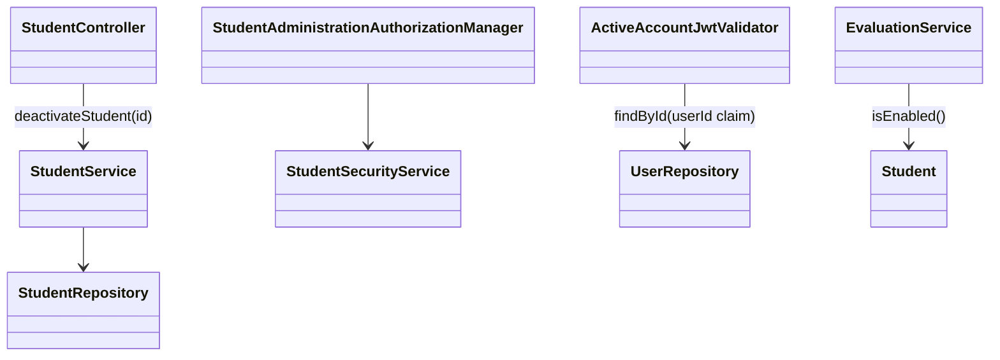
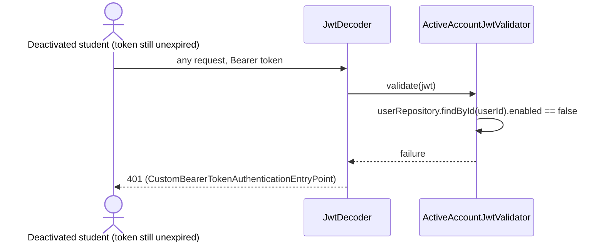

# Students (STU) Design

**Realizes:** [UC-STU-deactivate-student](../requirements/use-cases.md) · **Depends on:** FR-SEC-active-account · **Rules:** BR-student-lifecycle, BR-submission-owed, BR-evaluation-active-evaluatee, BR-section-scoped-access

The first design-of-record for the STU area. The other STU use cases were built before designs existed and are documented as-built in [`../traceability.md`](../traceability.md); add them here as they are designed.

## Overview

Deactivation becomes its own action instead of a side effect of the edit form. One new endpoint flips `enabled` to `false` after the instructor confirms a warning; nothing else about the student changes (she keeps her team, per BR-student-lifecycle). Three existing places are made to agree on what "deactivated" means: login and every later request (FR-SEC-active-account), who may be rated (BR-evaluation-active-evaluatee), and who appears in the section's peer evaluation report.

## Components & classes

| Layer | File | New / changed |
|---|---|---|
| Frontend view | `frontend/src/pages/students/Students.vue` (the list the edit form opens from) | changed: a Deactivate button in Operations, shown only for an active student |
| Frontend dialog | `ElMessageBox.confirm` listing the consequences (UC step 4) | new |
| Frontend api | `frontend/src/apis/student` | new `deactivateStudent(studentId)` |
| Controller | `backend/.../student/StudentController.java` | new `PATCH /students/{studentId}/deactivation` |
| Service | `backend/.../student/StudentService.java` | new `deactivateStudent(studentId)` |
| Authorization | `backend/.../security/authorizationmanagers/StudentAdministrationAuthorizationManager.java` → `StudentSecurityService.isCurrentUserCourseAdminOrInstructorOfStudentSection` | new |
| Security (trunk) | `backend/.../security/ActiveAccountJwtValidator.java`, wired into `SecurityConfiguration.jwtDecoder()` | new; affects every authenticated request |
| Evaluation | `backend/.../evaluation/EvaluationService.java` `addPeerEvaluation`, `generateWeeklyPeerEvaluationReportForSection` | changed |
| Exception | `backend/.../system/exception/StudentAlreadyDeactivatedException.java` + handler (409) | new |
| Reused unchanged | `SubmissionStatusService.findOwedItems` (already skips inactive, BR-submission-owed); `UserService.loadUserByUsername` (already refuses disabled at login) | — |



## Sequence

### UC-STU-deactivate-student: main success scenario

```mermaid
sequenceDiagram
  actor I as Instructor
  participant UI as Students.vue + confirm dialog
  participant SEC as SecurityFilterChain
  participant C as StudentController
  participant S as StudentService
  participant R as StudentRepository
  I->>UI: 1-2. open student (UC-STU-view-student)
  I->>UI: 3. Deactivate
  UI-->>I: 4. warning: loses access, keeps team, teammates stop rating her, history kept; Confirm / Cancel
  I->>UI: 5. Confirm
  UI->>SEC: PATCH /students/{id}/deactivation
  SEC->>SEC: ActiveAccountJwtValidator (caller active) + StudentAdministrationAuthorizationManager (3b)
  SEC->>C: allowed
  C->>S: deactivateStudent(id)
  S->>R: findById(id) (6a: 404)
  S->>S: already disabled? (3a: 409)
  S->>R: save(enabled=false)
  C-->>UI: 200 Result(StudentDto)
  UI-->>I: 6. "Student deactivated"
```

### Extension 6b: the student's next request



## API contract

| Method & path | Who may call | Request | Success | Errors |
|---|---|---|---|---|
| `PATCH /students/{studentId}/deactivation` | course admin of the student's course, or an instructor assigned to her section (BR-student-lifecycle) | none | 200, the student with `enabled=false` | 3a: 409 already deactivated · 3b: 403 · 6a: 404 not found · caller deactivated: 401 |
| `POST /evaluations` (existing, changed) | student (unchanged) | unchanged | unchanged | new: 400 when the evaluatee is deactivated (BR-evaluation-active-evaluatee) |

5a (cancel) makes no request.

## Key decisions

- **Keep her on her team.** Rejected: setting `team = null` on deactivation, because the section report lists team members only, so her past evaluations would vanish from the team record, and reactivation would have to remember the team.
- **Check `enabled` on every request with a JWT validator.** Rejected: accepting the 2-hour token window (contradicts FR-SEC-active-account) and a token blocklist (new state to keep). Cost: one user lookup per authenticated request. A validator failure is a 401 through the existing bearer entry point. This is the trunk commit.
- **A dedicated endpoint rather than the generic `PUT /students/{id}`.** The generic PUT still lets any `ROLE_instructor` set `enabled` with no section check and no confirmation; out of scope to remove here (it also serves reactivation until UC-STU-reactivate-student is built). Recorded as an open risk.
- **Authorization manager admits a missing student for an instructor** so 6a returns 404 rather than 403; a student caller is never admitted.
- **Report filter by week, not by deactivation date.** There is no deactivation timestamp; "has at least one evaluation of her for the week" implements BR-evaluation-active-evaluatee without a schema change.

## Data model

No change. `PeerEvaluationUser.enabled` already exists.

## Tests

| # | Flow | Level | Asserts |
|---|---|---|---|
| T1 | Main scenario | unit (`StudentServiceTest`) | active student → `enabled` false, team unchanged, saved |
| T2 | Main scenario | integration (`StudentIntegrationTest`) | section instructor PATCH → 200, `enabled=false`; she cannot log in afterwards |
| T3 | 3a already deactivated | unit + integration | 409, student unchanged |
| T4 | 3b not her instructor | integration | instructor of another section → 403; student caller → 403; student still enabled |
| T5 | 3b course admin | integration | course admin of her course (not assigned to her section) → 200 |
| T6 | 5a cancel | — (frontend only; no request is made) | not automated; manual check |
| T7 | 6a not found | unit + integration | unknown id → 404 |
| T8 | 6b logged-in student | integration | token obtained before deactivation → 401 on next request after it |
| T9 | BR-evaluation-active-evaluatee: no new ratings | unit (`EvaluationServiceTest`) | evaluation of a deactivated teammate → rejected, not saved |
| T10 | BR-evaluation-active-evaluatee: report history | unit (`EvaluationServiceTest`) | deactivated student with evaluations that week is listed; with none that week is not |
| T11 | BR-submission-owed (reused) | unit (existing `SubmissionStatusService` tests) | deactivated student owes nothing and is not owed — confirm an existing test covers it |

## Open questions / risks

- The generic `PUT /students/{id}` can still change `enabled` without the section check (see Key decisions). Follow-up issue.
- One extra query per authenticated request (ActiveAccountJwtValidator).
